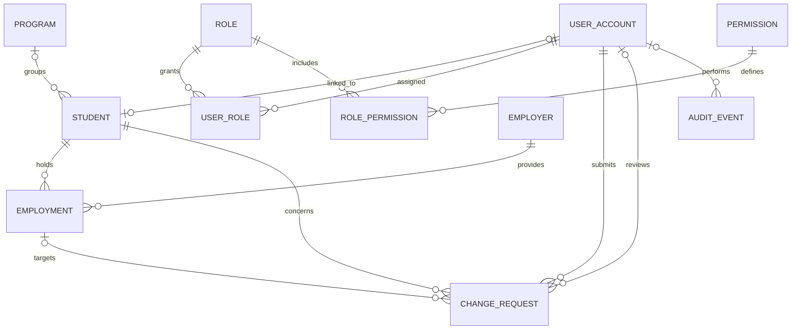

# Onyx Reborn — Proposed Relational Database Schema

Date: October 8, 2026
Status: Proposed design; requires reconciliation with Bob's legacy inspection report.
Authoring: Clarence's decisions organized by ChatGPT. This document is planning material, not Bob implementation evidence.
Target repository path: `docs/design/DATABASE_SCHEMA.md`

## 1. Purpose and scope

Modernize the 1998 BSSI student and employment workflows using Python FastAPI, Jinja2 pages, SQLite through SQLAlchemy, and pytest. React and PostgreSQL remain roadmap items. This specification does not establish that any tables, authentication, or tests have been implemented.

Required finish line: authorized staff can create, find, view, and edit students; record two simultaneous jobs; end one job without losing its history; and run a report. Account access and administration support this workflow. Student self-service is an optional extension subject to the October 11 checkpoint, with the staff-only fallback retained.

The application is one modular project. Staff services must not depend on the optional student portal. Disabling portal routes and navigation must leave staff operations working.

## 2. Screen-to-data flow

| Screen or action | Data used | Expected result |
|---|---|---|
| Welcome | No student tables | Sign in leads to account authentication. |
| Login and conditional MFA | Identity provider; local account and permissions after verification | Successful authentication leads to a role-appropriate dashboard. No SSN or student-number credentials. |
| Dashboard | Students and employment | Derive KPIs from actual records; distinguish job counts from distinct student counts. |
| Student directory and record | Student; optional program | Search by approved fields such as name or generated student number. |
| Create/edit student | Student | Validate and save; generate an immutable student number on creation. |
| Employment | Employment and employer | Show current jobs and history separately. |
| End job | Employment | Save end date and preserve the employment row. |
| Reports | Student, program, employer, employment | Use documented filters and counting definitions. |
| Administration | Account, roles, permissions | Authorized administrators manage access and account activation. |
| Optional student portal | Own student record and requests | Proposed changes remain pending until an authorized decision. |
| Review queue | Change request and current target record | Approval applies validated changes atomically; stale proposals require review. |

## 3. Relationships

An account can optionally link to one student; a student may exist without a login. The one-program-per-student model is provisional. If the legacy requirements require multiple enrollments or program history, replace that relationship with an enrollment table before implementation.

## 4. Common conventions

- Integer primary keys are internal identifiers. Foreign keys reference those identifiers, not names or email addresses.
- Store dates separately from UTC timestamps. Display timestamps in the appropriate user timezone.
- Use named status values with validation; the allowed sets below are proposals.
- Add `created_at` and `updated_at` to mutable records. Student and employment rows also have an integer `version` for conflict detection.
- Enforce foreign keys, uniqueness, and check constraints in the database as well as request validation. Bob must verify SQLite foreign-key enforcement on every connection.
- Prefer portable SQLAlchemy types and explicit migrations to preserve the PostgreSQL upgrade path.

## 5. Proposed tables

### USER_ACCOUNT

| Field | Rule |
|---|---|
| id | Primary key |
| provider | Identity provider/issuer identifier; final format unresolved |
| provider_subject | Stable identifier returned by that provider |
| display_name | Optional display label |
| email | Optional contact/display value, not the primary identity key |
| active | Boolean; inactive accounts denied application access |
| created_at, updated_at | UTC timestamps |

Unique constraint: `(provider, provider_subject)`. Do not match or grant access solely because an email address matches a student record. Account linking requires an authorized process.

### ROLE, USER_ROLE, PERMISSION, ROLE_PERMISSION

| Table | Fields and rules |
|---|---|
| ROLE | `id`, unique `name`; proposed names: Administrator, Staff, Student |
| USER_ROLE | `user_account_id`, `role_id`; composite primary key prevents duplicate assignments |
| PERMISSION | `id`, unique `code`, description |
| ROLE_PERMISSION | `role_id`, `permission_id`; composite primary key |

Proposed permissions: `students.read`, `students.manage`, `employment.manage`, `reports.read`, `accounts.manage`, `student_updates.approve`, and `self_service.use`.

Approval authority must be explicit, not inferred from a visible button. If only selected staff may approve updates, use a dedicated reviewer role containing `student_updates.approve`; do not give that permission to every Staff account. Final role combinations require Clarence's review. Student access additionally requires ownership checks on every request, regardless of role permissions.

### PROGRAM

Fields: `id` primary key, unique `code`, `name`, `active`, timestamps. This catalog is provisional pending legacy field reconciliation.

### STUDENT

| Field | Rule |
|---|---|
| id | Primary key |
| student_number | Unique generated identifier; immutable; format to be agreed |
| user_account_id | Nullable, unique foreign key to USER_ACCOUNT |
| first_name, last_name | Required; final name-field requirements subject to analysis |
| email, phone | Optional contact details; not credentials |
| program_id | Nullable foreign key to PROGRAM; enrollment model unresolved |
| status | Proposed: active, inactive, archived |
| version | Required integer, initially 1; increment on accepted change |
| created_at, updated_at | UTC timestamps |

No SSN field. Archive behavior is a proposal; do not implement hard deletion of students with related records. Do not invent additional required personal fields from a mockup.

### EMPLOYER

Fields: `id` primary key, `name` required, optional organization/contact details justified by the legacy requirements, `active`, timestamps. Names need not be globally unique: distinct organizations can share a name. Agree a duplicate-review policy rather than merging automatically.

### EMPLOYMENT

| Field | Rule |
|---|---|
| id | Primary key |
| student_id | Required foreign key to STUDENT |
| employer_id | Required foreign key to EMPLOYER |
| job_title | Required, subject to legacy review |
| job_type | Proposed: part_time, full_time, other; final categories unresolved |
| hours_per_week | Optional numeric value; cannot be negative |
| start_date | Required date, subject to legacy review |
| end_date | Nullable date; cannot precede start_date |
| version | Required integer, initially 1; increment on accepted change |
| created_at, updated_at | UTC timestamps |

Do not make `student_id` unique: multiple simultaneous jobs are required. Do not make `(student_id, employer_id)` unique: a student may return to an employer later.

Proposed current-job definition for an as-of date: `start_date <= as_of` and (`end_date` is null or `end_date >= as_of`). End date is inclusive under this proposal. Future jobs are not current yet. Confirm this convention before coding and use it consistently in reports and dashboard KPIs.

### CHANGE_REQUEST — optional student self-service

| Field | Rule |
|---|---|
| id | Primary key |
| student_id | Required foreign key to STUDENT |
| submitted_by_account_id | Required foreign key to USER_ACCOUNT; verify ownership |
| request_type | Proposed: add_job, update_job, end_job, update_student |
| target_employment_id | Nullable foreign key; required for update_job/end_job |
| applied_employment_id | Nullable foreign key; records the employment created by approved add_job |
| proposed_values | Validated JSON object containing only allowed fields; request payload, not official student/job storage |
| base_record_version | Required for changes to an existing target; null for add_job |
| status | pending, needs_correction, approved, rejected, cancelled |
| reviewed_by_account_id | Nullable foreign key to USER_ACCOUNT |
| review_feedback | Decision/correction explanation |
| submitted_at, reviewed_at | UTC timestamps; reviewed_at nullable |
| version | Integer for competing review/update detection |
| created_at, updated_at | UTC timestamps |

For update_student, `student_id` identifies the target. For job changes, verify that the target employment belongs to that student. Add-job proposals must have no existing target. Allowlist and type-check JSON fields; never accept arbitrary model fields or credential changes.

Approval must check permission, ownership/target consistency, pending state, and current record version within one transaction. Apply the official change, increment the official record version, record the decision, and append an audit event atomically. A second approval cannot apply the same request again. Rejection changes no official student or employment values. A stale target blocks approval until the reviewer resolves the conflict.

Proposed transitions: pending → approved/rejected/needs_correction/cancelled; needs_correction → pending/cancelled. Approved, rejected, and cancelled are terminal. Resubmission replaces the proposal and refreshes its base version through an authorized workflow; preserve earlier content in a request revision table if full proposal history is required. Revision scope remains open.

### AUDIT_EVENT

Fields: `id`, nullable `actor_account_id`, `event_type`, `entity_type`, `entity_id`, optional `change_request_id`, `occurred_at`, and a minimal allowlisted change summary. Use append-only application behavior.

The generic entity reference is not a database foreign key; application validation must maintain its meaning. Account deletion must not destroy audit history. Do not log passwords, tokens, MFA secrets, full request bodies, or unnecessary personal information. Full field-level history and retention requirements remain unresolved.

## 6. Authentication and MFA boundary

Welcome → Login → MFA when required → Role-appropriate dashboard.

With an established provider, credentials and MFA enrollment, challenges, and recovery are provider responsibilities. Local tables store stable identity links and application permissions. Do not build an MFA-code table or treat a student number/SSN as a password. Validate provider identity before creating an application session; MFA completion requirements must follow the agreed provider policy.

MFA scope is unresolved: who must use it, which provider/method, when it is required, enrollment/recovery, and whether it is MVP or roadmap. The current MFA images are conditional design examples. Private hosting alone does not establish authentication or authorization.

## 7. Integrity, indexes, and history

- Restrict deletion of referenced students, employers, and employment records; prefer deactivation/archive where agreed. Never cascade-delete employment history or requests when removing access.
- Suggested indexes: student name search, employment student and employer foreign keys, employment date filters, change-request status/submission time, student request history, and audit entity/time. Verify indexes against actual queries.
- Ended employment rows provide job history. They do not by themselves provide complete field-edit history; use audit events and a reviewed history design if required.
- Treat multi-row changes as transactions. Use version-checked writes so concurrent edits cannot silently overwrite newer records.
- Reports query official records only. Pending requests are excluded from employment totals. Optional pending-request KPIs must disappear when the portal is disabled.

## 8. Fictional example and acceptance checks for Bob

Fictional student Ava Johnson has generated number STU-0104. She has one employment row at Campus Bookstore and another at Community Library. Ending the bookstore job changes that row's end date. The library job remains active, and the bookstore job remains visible in history.

Bob should verify:

1. Student creation generates a unique immutable number; required-field validation works.
2. One student can hold two simultaneous jobs, including repeated employment at the same employer across different periods.
3. Ending one job retains its history and leaves the other job unchanged.
4. Invalid dates and negative hours are rejected; foreign-key failures cannot create orphan rows.
5. Current-job reporting handles future starts and the agreed end-date boundary correctly; distinct-student counts differ correctly from job counts.
6. Unauthorized accounts cannot access staff/admin actions; students cannot access another student's record or requests.
7. Pending/rejected requests leave official records unchanged; authorized approval applies once, atomically.
8. Stale proposals and concurrent edits cannot overwrite newer records.
9. Disabling self-service leaves staff create/edit/employment/report flows working.
10. Audit entries omit credentials and unnecessary personal data.

These are proposed checks, not completed test results.

## 9. Decisions before implementation

| Decision | Current state |
|---|---|
| Required legacy fields and reports | Reconcile VB4 source, capstone document, and Bob's analysis |
| Program/enrollment cardinality | One current program proposed; multiple enrollment/history unresolved |
| Identity provider and MFA scope | Unresolved; no provider or paid service selected |
| Exact roles and reviewer assignment | Proposed permissions; Clarence to confirm assignments |
| Student number format | Unresolved; unique, immutable, no SSN |
| Employment categories/date conventions | Proposed; confirm before coding |
| Optional portal scope | Attempt only after staff core passes; October 11 fallback gate |
| Request revisions and audit retention | Unresolved; keep MVP scope explicit |

## 10. Safety and implementation handoff

Use fictional demo data. Never upload or commit any BSSI `.zip` or `.mdb` file. Preserve original legacy folders. This document does not authorize moving/deleting originals, publishing the demo, or adopting paid services.

Bob writes application code. ChatGPT and Claude plan/review/explain. Record each Bob session's prompt, output, Clarence's corrections, commit ID, and actual test results; do not credit this schema document as Bob-authored work.

Suggested Bob prompt:

> Read `docs/analysis/legacy-inspection-report.md`, `docs/design/UI_FLOW.md` when available, and `docs/design/DATABASE_SCHEMA.md`. Reconcile this proposed schema against the reviewed legacy source and capstone requirements. Separate verified legacy rules, modernization decisions, and unresolved assumptions. Identify conflicts and propose the smallest staff-first model. Do not implement application code until Clarence has resolved the listed blockers. Keep student self-service optional and preserve multiple-job history. Explain every proposed change.

Resume point: requirements/schema review → approved screens and identity scope → Bob staff implementation and checks → optional portal gate → deployment and submission evidence.
